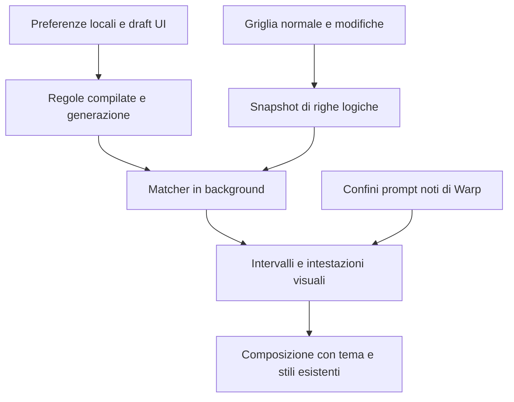

# Highlight tramite trigger e intestazioni del prompt — specifica tecnica

Stato: implementazione locale dietro `FeatureFlag::TerminalHighlighting`.
Attivazione, verifiche e limiti del rilascio: [IMPLEMENTATION.md](IMPLEMENTATION.md).
Requisiti: [PRODUCT.md](PRODUCT.md). Analisi del repository al commit
`eafc6d18d18bea8c6cf78dc21a4e0eab59f4c6c6`.

## Fattibilità e punti di integrazione verificati

L'implementazione è fattibile senza modificare il flusso PTY o richiedere un servizio remoto. Warp
possiede già griglie, coordinate delle celle, un percorso di ricerca regex e rendering di match.
Le integrazioni da implementare sono nuove: le API seguenti sono riferimenti da riutilizzare, non
un motore di trigger già esistente.

| Area esistente | Utilizzo previsto |
| --- | --- |
| `crates/warp_terminal/src/model/find.rs` | Riferimento per coordinate dei match e attraversamento delle griglie |
| `crates/warp_terminal/src/model/grid/grapheme_cursor.rs` | Attraversamento dei grafemi, wide char e soft wrap |
| `crates/warp_terminal/src/model/grid/grid_handler.rs` | Tracking delle modifiche, confini delle righe logiche e troncamento |
| `crates/warp_terminal/src/model/grid/displayed_output.rs` | Mappatura fra righe originali e righe visualizzate dopo un filtro |
| `app/src/terminal/find/model/async_find.rs` | Riferimento per lavoro incrementale, generazioni e risultati asincroni |
| `app/src/terminal/block_list_element.rs` e `blockgrid_renderer.rs` | Passaggio degli overlay alle griglie di output e alle intestazioni storiche |
| `app/src/terminal/grid_renderer.rs` e `grid_renderer/cell_type.rs` | Composizione dei colori, percorsi con e senza ligature |
| `app/src/terminal/model/header_grid.rs` | Confini conosciuti fra prompt e comando, senza inferenze regex |
| `app/src/terminal/prompt_render_helper.rs` e `input/classic.rs` | Prompt attivo Classic/PS1, anche quando incorporato nell'editor |
| `app/src/terminal/settings.rs` e `app/src/settings/initializer.rs` | Registrazione, persistenza e inizializzazione delle preferenze |
| `app/src/settings_view/appearance_page.rs` | Controlli, ricerca nelle impostazioni e azioni della palette |

La complessità principale è l'invalidazione delle coordinate e l'integrazione dell'intestazione
attiva nei diversi renderer. Non va subordinato il matching dell'output alla warpification o alla
presenza di blocchi per ogni comando: una griglia di output senza integrazione è un input valido.

## Struttura proposta



Moduli introdotti:

- `crates/warp_terminal/src/model/highlight.rs`: tipi indipendenti dalla UI, compilazione regex,
  matching delle righe logiche e conversione degli offset in intervalli di celle.
- `app/src/terminal/highlight/model.rs`: scheduling condiviso, cache, invalidazione e snapshot
  immutabili per il rendering. Nessuna dipendenza dal controller della ricerca attiva.
- Le intestazioni regex risiedono nel matcher condiviso; quelle da metadati e le decorazioni
  risolte risiedono in `app/src/terminal/highlight/model.rs`, senza cambiare il lifecycle dei comandi.
- `app/src/terminal/highlight/settings.rs`: gruppo di preferenze, schema e validazione.
- `app/src/settings_view/highlighting/`: gestione dei draft, editor regole e anteprime.

Il motore condiviso restituisce colori simbolici e coordinate, senza `Appearance`, elementi WarpUI
o lock di `TerminalModel`. La compilazione di regole e del pattern del prompt avviene al caricamento
e al salvataggio; mai nel ciclo di paint. Le compilazioni dei draft vengono accorpate e i risultati
di draft superati scartati.

## Preferenze e modello dati

Usare il sistema `Setting` esistente, `SettingSurfaces::GUI`, `SupportedPlatforms::DESKTOP` e
`SyncToCloud::Never`. Registrare il gruppo nell'initializer e nel sistema di schema. Non aggiungere
tabelle SQLite, API GraphQL o impostazioni remote.

Contratto TOML proposto:

```toml
[terminal.highlights]
enabled = true

[[terminal.highlights.rules]]
id = "c6c530bc-247f-40a7-9b17-9b149d1b6794"
name = "Errori"
enabled = true
pattern = '\b(ERROR|FATAL|PANIC)\b'
case_sensitive = false
target = "text"
foreground = "ansi:bright_red"

[[terminal.highlights.rules]]
id = "876d4222-adf4-4565-9520-e9878d734672"
name = "Avvisi"
enabled = true
pattern = '\bWARN(ING)?\b'
case_sensitive = false
target = "line"
foreground = "#FFE082"
background = "#3B2F12"

[terminal.prompt_header]
enabled = true
background = "theme:surface_2"
# Omettere foreground per conservare i colori ANSI del prompt.
foreground = "#B8D7FF"
show_separator = true
separator = "theme:accent"
# Lo spazio finale fa parte del pattern.
fallback_regex = '^[\w.-]+@[\w.-]+:[^#$\r\n]*[#$] '
```

`HighlightRule` contiene i campi dell'esempio; l'ordine del vettore esprime la priorità. `id` è un
UUID stabile creato dall'editor, usato per editing, duplicazione e diagnostica. La duplicazione
genera un nuovo ID. Le regex restano stringhe nella configurazione; il runtime mantiene separatamente
le versioni compilate.

`HighlightColor` accetta `#RRGGBB` e i 16 nomi `ansi:*` della palette. Le preferenze
dell'intestazione accettano anche un insieme chiuso di token `theme:surface_2`, `theme:foreground`,
`theme:outline` e `theme:accent`. I token vengono risolti al rendering: cambiare tema non richiede
ricompilazione né matching. Non introdurre colori RGBA o trasparenza configurabile nella v1.

Default: `highlights.enabled = true`, `rules = []`, `prompt_header.enabled = false`, foreground
del prompt assente, background `theme:surface_2`, separatore visibile `theme:outline`, regex di
fallback assente. L'esempio abilita entrambe le funzioni intenzionalmente.

La validazione richiede nome e pattern non vuoti, ID univoci, target noto e almeno un colore per
regola. Gli errori di sintassi TOML seguono il comportamento del settings manager esistente. Per
errori semantici in dati correttamente deserializzati, isolare la singola regola e mostrarne lo stato
in Settings, conservando le regole valide. Un fallback del prompt invalido disabilita soltanto il
riconoscimento regex, non gli highlight o il percorso tramite metadati.

## Semantica delle regex e delle coordinate

Usare `regex::RegexBuilder` della dipendenza workspace, con sensibilità alle maiuscole configurata
per regola e Unicode attivo. Capture group ammessi per comporre il pattern; si colora solo il match
completo. Nessun lookaround o backreference. La
[documentazione di regex](https://docs.rs/regex/1.11.1/regex/) descrive questi limiti e distingue il
costo di una singola ricerca dal costo potenzialmente maggiore dell'iterazione di tutti i match.
Non considerare l'assenza di backtracking una garanzia sufficiente di latenza.

Per ogni riga logica produrre uno snapshot UTF-8 e una mappa da intervalli di byte a grafemi/celle.
Riutilizzare contenuto dei grafemi, larghezze e convenzioni di estrazione della griglia;
`UnicodeSegmentation` costruisce la mappa dell'anteprima. Non convertire gli offset UTF-8 in
colonne tramite semplice conteggio dei caratteri.

- Unire soltanto righe collegate da soft wrap; non inserire separatori fra esse.
- Non includere newline finale o padding artificiale della griglia nella stringa di matching.
  Conservare gli spazi presenti nel contenuto secondo la rappresentazione del terminale.
- Le sequenze ANSI sono già interpretate; tab e carriage return vengono osservati attraverso le
  celle risultanti. Nessuna normalizzazione Unicode aggiuntiva.
- Allargare un match che interseca parte di un grafema al grafema intero, includendo tutte le celle
  wide occupate. I wide spacer non devono introdurre caratteri aggiuntivi.
- Per `Text`, usare match non vuoti di `find_iter`; per `Line`, basta la prima corrispondenza non
  vuota per produrre lo stile di tutta la riga logica. Ignorare i match vuoti in entrambi i casi.
- Normalizzare gli overlay in intervalli ordinati non sovrapposti per riga originale. In ogni cella
  vince la regola abilitata con indice minore; le proprietà non specificate preservano la base ANSI.

I confini di prompt o blocco conosciuti interrompono il matching fra griglie. Senza integrazione
non si inventano confini di comando all'interno della griglia di output. Match dell'output e
riconoscimento regex del prompt usano la stessa estrazione del testo.

## Intestazioni: riconoscimento e rendering

Le decorazioni contengono intervalli del testo del prompt, righe interessate da sfondo e posizione
del separatore. Il matcher le restituisce in `LineHighlights`; il percorso dei metadati le
compone in `GridHighlights`. È una decorazione di presentazione, non un nuovo blocco nel modello
del terminale.

### Sessioni senza integrazione — requisito prioritario

Per ogni riga logica eleggibile, applicare `fallback_regex` e accettare soltanto un match non vuoto
con offset iniziale zero. Consigliare `^` nell'editor, ma verificare la posizione a runtime. La regex
del prompt è case-sensitive per default; l'utente può usare flag inline come `(?i)`.

Il match definisce il foreground del solo prompt. Sfondo e separatore usano tutta la riga logica
corrispondente secondo il contratto prodotto. Non costruire uno stato “comando in esecuzione”, non
intercettare Enter e non usare il testo riconosciuto per eseguire altre azioni.

La persistenza nello storico deriva dalle corrispondenze del testo conservato. Una riscrittura che
elimina il prefisso elimina la decorazione. Una riga di output che imita il prompt può generare la
stessa decorazione: è il limite esplicito del fallback e non si risolve con euristiche nascoste.

Il ramo deve funzionare con sessioni non bootstrapped, SSH legacy e subshell senza hook, anche se
l'input globale è Universal. Non dipendere da `SessionType::WarpifiedRemote` o `host_id` per attivarlo.

### Classic/PS1 con integrazione

Usare i confini validi esposti da `HeaderGrid` e `Block`, il flag `honor_ps1` del blocco storico e le
decisioni di rendering correnti del prompt attivo. Non usare il solo valore globale di Input Type
per classificare i blocchi storici.

Gestire i tre percorsi effettivi: griglia prompt/comando dei blocchi conclusi, prompt attivo come
elemento e prompt sulla stessa riga tramite decorator dell'editor. Passare gli intervalli e lo
stile già risolti ai renderer, senza riacquisire il lock del modello dentro helper o paint.

Lo sfondo include l'area di prompt e comando; l'override del foreground resta limitato al prompt,
compresi RPROMPT e righe note del prompt multilinea. La sintassi del comando e i controlli
dell'editor conservano il proprio stile. Il separatore usa il bordo esistente se coincide, evitando
due linee sovrapposte. Non cambiare PS1, le dimensioni della griglia o le posizioni del cursore.

Quando esistono metadati validi per un intervallo del prompt, hanno precedenza sul fallback e non
si disegna una seconda intestazione. La regex configurata viene comunque valutata sulle griglie
di output normale: il loro contenuto può includere SSH non integrato o subshell senza hook anche
quando la shell esterna è integrata. Questo evita di introdurre un nuovo sistema di rilevamento
delle shell annidate. Un output che imita il prompt può quindi essere decorato anche in una
sessione integrata; vale lo stesso limite esplicito del riconoscimento regex. Il caso SSH legacy
dentro shell integrata va coperto da un test dedicato, senza usare un booleano per tutta la pane.

## Scheduling, cache e invalidazione

Valutare righe visibili e un piccolo margine di prefetch; non scansionare l'intero scrollback quando
si attiva una regola. Lo storico viene colorato progressivamente entrando nel viewport.
L'intestazione Classic/PS1 con metadati non richiede regex.

Accorpare le modifiche dell'output e programmare snapshot limitati. Acquisire il lock esistente del
modello solo per estrarre dati e revisioni; matching, compilazione, emissione eventi e pubblicazione
avvengono dopo il rilascio. Non aggiungere lock annidati sullo stesso `TerminalModel`.

`GridHandler::take_find_dirty_rows_range()` è distruttivo ed è già consumato dalla ricerca. Il nuovo
controller non deve leggerlo e svuotarlo. Aggiungere tracking indipendente per gli highlight usando
gli stessi punti di mutazione, oppure un'API di fan-out esplicita che consegni l'invalidazione a
entrambi i consumer prima di svuotarla. Per la v1 preferire il tracking indipendente per limitare
il rischio di regressioni nella ricerca.

L'implementazione usa identità e revisione indipendenti di `GridHandler`, aggiornate ai batch PTY,
alle mutazioni dirette dello storage, al resize e al troncamento. Le coordinate preparate sono
associate a identità, revisione e intervalli originali del viewport; una revisione diversa ne
impedisce subito l'utilizzo. La sostituzione della configurazione separa le generazioni di regole.

La cache del matching usa snapshot immutabili del contenuto, con mappa delle celle e larghezza
della griglia. Righe concluse identiche riusano quindi il risultato anche quando cambia la
revisione della griglia. Un viewport invariato non ricostruisce snapshot. L'estrazione visita una
riga logica per volta per evitare di conservare una seconda copia di tutto il viewport sotto lock.
Questo sostituisce la revisione per regione inizialmente proposta e non consuma le invalidazioni
di Find.

| Evento | Effetto |
| --- | --- |
| Append o modifica delle celle | Invalidare le righe logiche toccate, estese ai vecchi e nuovi confini di soft wrap |
| Riscrittura, erase, insert/delete di righe | Invalidare le regioni interessate; nuova epoca se cambiano le coordinate |
| Resize/reflow, reset, troncamento, sostituzione di griglia | Nuova epoca; rimuovere coordinate precedenti e riprogrammare il viewport |
| Scroll o filtro | Richiedere nuove righe originali; rimappare in visualizzazione senza unire righe nascoste |
| Regole o regex del prompt modificate | Nuova generazione; rimuovere risultati precedenti e rivalutare il viewport |
| Tema modificato | Risolvere nuovamente i colori simbolici, senza matching |
| Disabilitazione, alternate screen, chiusura sessione | Rimuovere overlay applicabili e cancellare il lavoro pendente |

Rimuovere subito gli overlay delle regioni invalidate: è preferibile vedere temporaneamente il
colore originale piuttosto che uno stile applicato a testo diverso. Prima di pubblicare un risultato
verificare tutte le revisioni della sua regione. Scartare risultati superati, anche dopo cambio
regole, uscita da SSH o cancellazione della sessione. Coalescere il lavoro pendente della stessa
regione e dare precedenza alla versione recente e al viewport corrente.

## Composizione degli stili

Il renderer riceve intervalli immutabili già ordinati; non esegue regex o scheduling. I colori dei
trigger costituiscono un override della base ANSI risolta, incluso `INVERSE`. In una riga riconosciuta
come intestazione, lo stile dell'intestazione ha precedenza sul colore trigger per le proprietà
che specifica; il resto della riga può mantenere il foreground dei trigger.

Questa nuova base è un fallback per gli stati visivi esistenti. Ricerca, filtro, hover, selezione e
cursore mantengono i propri criteri e il proprio ordine relativo. Redazione e oscuramento dei
segreti si applicano sempre e non vengono influenzati dalla decorazione.

Aggiornare sia il percorso con ligature sia quello senza. Separare gli style run ai confini dei
match; non colorare accidentalmente l'intera ligature. Mappare le coordinate originali tramite
`DisplayedOutput` per i blocchi filtrati. Non decorare immagini inline o i separatori del filtro.

Lo sfondo personalizzato deve essere effettivamente visibile anche su celle ANSI con background
predefinito trasparente. La correzione del contrasto considera il nuovo sfondo e rispetta le
preferenze esistenti, senza disattivazioni forzate. Le decorazioni non aggiungono contenuto al testo
copiato né ai dati di sessione condivisa: ogni client applica le proprie preferenze locali.

## Limiti e obiettivi di prestazione

Valori iniziali proposti, da confermare con benchmark prima del rollout:

| Risorsa | Limite iniziale |
| --- | --- |
| Regole di highlight | 64 |
| Lunghezza di un pattern, incluso il fallback prompt | 4 KiB UTF-8 |
| Dimensione compilata per regex | 1 MiB tramite `RegexBuilder::size_limit` |
| Riga logica valutabile | 16 KiB UTF-8 |
| Attraversamento di una riga con soft wrap | 512 righe visive |
| Corrispondenze non vuote di highlight per riga, complessive | 512, valutando prima le regole prioritarie |
| Cache e snapshot pendenti degli highlight | Budget totale 16 MiB per client, con espulsione LRU |
| Worker di matching | Pool condiviso limitato, massimo 2 task attivi |

Non troncare una riga a 16 KiB fingendo che sia completa: altererebbe ancore e matching. Saltare
l'intera riga oltre soglia, incluso il riconoscimento del prompt, e mostrare una diagnostica
aggregata in Settings. Anche attraversamento dei confini e costruzione dello snapshot devono
essere limitati, senza percorrere una riga arbitrariamente lunga sotto lock. Il limite di 512
ferma l'aggiunta di match successivi senza invalidare quelli già accettati; la diagnostica segnala
la limitazione. Non creare un toast per ogni riga saltata.

L'anteprima deve applicare gli stessi limiti. Nomi, regex, prompt e contenuto del terminale non
vanno inseriti in log o telemetria; per la v1 non è richiesta nuova telemetria di prodotto.

Obiettivi su build release con hardware e fixture dichiarati: nessuna scansione quando non ci sono
regole né intestazioni abilitate; nessun matching nel paint; p95 del tempo di lock per snapshot
entro 2 ms; p95 dell'aggiornamento di highlight entro 50 ms dopo l'ultima modifica della regione;
regressione del throughput PTY entro il 5% con 20 regole rappresentative su almeno 10 MiB di log.
Misurare separatamente foreground, whole-line e regex prompt. I valori sono budget da validare,
non misurazioni già effettuate.

## UI e rilascio

In Appearance usare widget ricercabili distinti per toggle, gestione delle regole, colori
dell'intestazione e riconoscimento del prompt. Le intestazioni delle sezioni appartengono ai
rispettivi widget; non inserire un widget che contenga solo il titolo. Riutilizzare editor,
selettori, temi dei pulsanti e handle di input persistenti del progetto.

L'anteprima dell'intestazione deve indicare quale prefisso è stato riconosciuto, mostrare due
comandi consecutivi e permettere di confrontare conservazione e override dei colori ANSI. Nessuna
riscrittura automatica della regex o inserimento di hook nella shell.

Introdurre `FeatureFlag::TerminalHighlighting` con controlli runtime. Il flag governa inizializzazione,
schema delle preferenze, UI e azioni Command Palette; la disabilitazione non cancella le preferenze.
I due toggle utente restano indipendenti. Usare context flag per mostrare l'azione Enable o Disable
appropriata nella palette. Dogfood dopo la verifica locale, poi Preview e Stable secondo la normale
procedura di rollout del progetto.

## Piano di verifica

I test Rust vanno in file separati `*_tests.rs` secondo AGENTS.md. Durante l'implementazione
consultare le skill di test Rust, integrazione GUI e verifica cross-platform pertinenti.

| Livello | Casi essenziali |
| --- | --- |
| Matcher | Tutti i match, case sensitivity, pattern invalidi, match vuoti, priorità e limiti |
| Coordinate | UTF-8, CJK, emoji e combining mark, soft wrap, spazi finali, `^` e `$` |
| Controller | Output frammentato, `\r` più erase, risultati fuori ordine, cancellazione, reflow e troncamento |
| Ricerca concorrente | Find attivo mentre arriva output: entrambi i consumer ricevono invalidazioni |
| Sessioni | Locale warpified, SSH warpified, SSH legacy dentro shell integrata, subshell senza hook |
| Prompt regex | Prefisso corretto/assente, comando sulla stessa riga, soft wrap, output simile al prompt, modifica pattern |
| Prompt noto | Classic/PS1, multilinea, RPROMPT, prompt attivo nell'editor e intestazioni concluse |
| Renderer | Con/senza ligature, ANSI inverse e true color, contrasto, sfondi, filtro, ricerca, selezione e segreti |
| Settings | Round trip TOML, errori isolati, persistenza toggle, ricerca widget e azioni palette |
| Prestazioni | Baseline disabilitata, log con 20/64 regole, righe lunghe, molte pane e resize ripetuti |

La verifica visuale deve includere due comandi consecutivi in una sessione realmente senza
integrazione, non soltanto un mock di Classic. Copiare l'output e confrontarlo con la versione senza
decorazioni. Ripetere almeno un percorso su ciascun OS desktop, selezionando i runner disponibili
secondo la skill cross-platform. Usare shell POSIX e PowerShell per verificare prompt e newline.

Sequenza di validazione prevista: test mirati del matcher (`cargo nextest run -p warp_terminal
highlight`), test mirati dei moduli app e dei renderer, Clippy dei package modificati, controlli di
schema e formattatori applicabili una volta alla fine. I filtri definitivi vanno adattati ai nomi
dei test effettivamente implementati. Non richiedere un presubmit completo per questa feature;
rispettare l'ordine di validazione di AGENTS.md.

## Suddivisione dell'implementazione

1. **Verifica dei percorsi:** fixture per SSH senza integrazione, Classic/PS1 e output warpified;
   confermare griglie eleggibili, segnali di transizione e mappatura dei prompt. Stabilire baseline
   di prestazione e punti di invalidazione prima di cambiare il renderer.
2. **Core e configurazione:** modello dati, schema, compilazione con limiti, estrazione dei grafemi,
   matcher e test delle coordinate.
3. **Output highlight:** controller incrementale, invalidazioni indipendenti da Find, cache e
   composizione in entrambi i renderer. Verificare subito sessioni warpified e non integrate.
4. **Prompt header:** fallback regex nelle sessioni senza integrazione, sfondo e separatore;
   collegare poi i metadati esistenti di Classic/PS1 e il prompt attivo nell'editor.
5. **Configurazione utente:** widget, anteprime, gestione delle regole e azioni Command Palette.
6. **Verifica e rollout:** regressioni, misure, controllo visuale sui tre OS e abilitazione Dogfood.

La feature è completa solo includendo highlight in entrambi i tipi di sessione e intestazioni
configurabili nelle sessioni senza integrazione. Il supporto Classic/PS1 è un riuso previsto,
ma non deve ritardare né sostituire il requisito prioritario delle sessioni non integrate.
